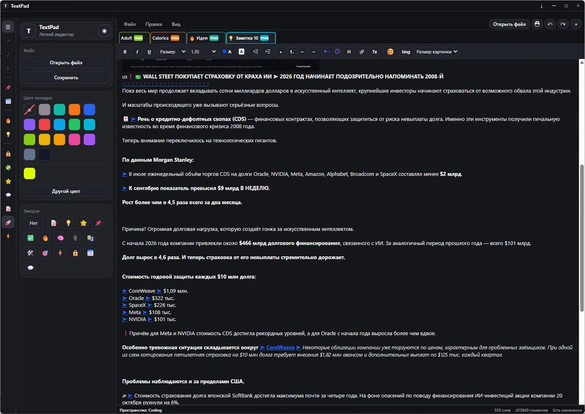

# TextPad - редактор заметок и документов

**Коммерческий проект. Исходный код закрыт.**

Этот репозиторий содержит описание проекта и демонстрационные материалы. В портфолио кнопка «Код» показывает только структуру папок и имена файлов.

Автор проекта - **Евгений Толмачев**. [Профиль GitHub](https://github.com/EvgenyET) · [Проект в портфолио](https://evgeny-dev.pro/project.html?id=TextPad)

Редактор заметок для Windows с рабочими пространствами, цветными вкладками и автосохранением. Восстанавливает черновики и сессию, поддерживает форматирование и экспорт DOCX.

## Задача проекта

Задача редактора - поддерживать непрерывную работу с заметками между запусками. Поэтому файловые операции, черновики, метаданные вкладок и восстановление пространства связаны в едином сценарии. В текущую Wails-сборку встроен интерфейс на JavaScript, ранний вариант на Svelte сохранён в проекте.

## Мой вклад

Разработал Go-часть приложения и связал её с интерфейсом через Wails. Реализовал открытие, сохранение и переименование файлов, автосохранение черновиков, восстановление сессии и резервные копии. Подготовил рабочие пространства, вкладки с цветами и значками, форматирование, экспорт DOCX и поведение окна в системном трее.

## Интерфейс

**Выбор значка для вкладки**

**Редактор с открытым документом в тёмной теме**

## Как работает приложение

TextPad предназначен для повседневной работы с несколькими заметками и документами. Пользователь распределяет материалы по рабочим пространствам, различает вкладки по цветам и значкам, редактирует текст и сохраняет нужные файлы. Черновики и состояние сессии восстанавливаются при следующем запуске. Для передачи документа предусмотрен экспорт в DOCX, а рабочее пространство можно сохранить в резервную копию.

## Возможности

- Открытие и сохранение текстовых файлов, Markdown и собственного формата .tpad.
- Вкладки, цвета и значки документов, отдельные пространства для заметок и дел.
- Автосохранение черновиков, восстановление и ручные резервные копии рабочих пространств.
- Форматирование текста и экспорт содержимого документа в DOCX.
- Работа в системном трее и восстановление окна с сохранёнными размерами.
- Сохранение файлов рабочего пространства и переименование открытого документа.

## Техническое устройство

### Окно и жизненный цикл

Wails создаёт настольное окно, встраивает подготовленные ресурсы интерфейса и связывает его с Go. Обработчик повторного запуска передаёт открываемый файл уже запущенному приложению.

### Файлы и восстановление

Go backend открывает и сохраняет файлы, управляет черновиками и метаданными вкладок, создаёт и читает резервные копии пространства.

### Редактор и пространства

Текущий встроенный интерфейс на JavaScript управляет вкладками, пространствами, форматированием и локальным состоянием. В репозитории также сохранён ранний интерфейс на Svelte и TypeScript.

### Экспорт документов

Собственный Go-модуль преобразует текст и HTML-представление документа в структуру DOCX, формирует параграфы, стили и связанные изображения.

## Технологии

| Технология | Роль в проекте |
| --- | --- |
| Go | Файловые операции, черновики, резервное копирование и экспорт DOCX. |
| Wails | Связь Go backend с webview и управление настольным окном. |
| JavaScript / HTML / CSS | Текущий встроенный редактор и интерфейс рабочих пространств. |
| Svelte / TypeScript | Ранняя версия интерфейса, сохранённая в frontend/src. |
| DOCX | Формат экспорта документов с текстом, форматированием и изображениями. |

## Состояние показанной версии

- Поддерживается экспорт в DOCX. Для открытия и редактирования используются текстовые файлы, Markdown и собственный формат .tpad.

## Демонстрация

На странице портфолио доступны описание, галерея и видеодемонстрация проекта. [Открыть TextPad - редактор заметок и документов](https://evgeny-dev.pro/project.html?id=TextPad).
