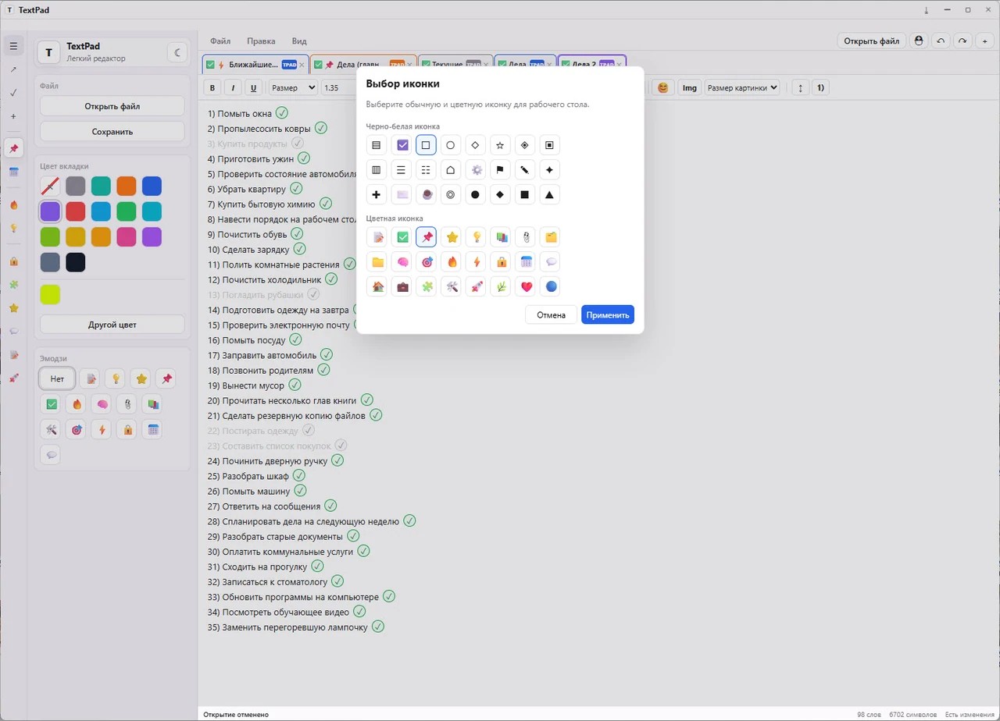

# TextPad - редактор заметок и документов

**Автор проекта:** [Евгений Толмачев](https://github.com/EvgenyET) · [Страница проекта в портфолио](https://evgeny-dev.pro/project.html?id=TextPad)

Редактор Windows с цветными вкладками, автосохранением черновиков и экспортом в DOCX. Заметки можно разделить по рабочим пространствам и восстановить из резервной копии.

## Мой вклад

Разработал редактор для Windows на Go, Wails и Svelte. Реализовал вкладки с цветами и значками, открытие и сохранение файлов, автосохранение черновиков и восстановление рабочего пространства после перезапуска.

## Интерфейс

**Выбор значка для вкладки**

**Редактор с открытым документом в тёмной теме**

## Как это работает

TextPad объединяет локальные файлы и несколько пространств для заметок и дел. Вкладки можно различать по цвету и значку, а черновики и состояние рабочего пространства сохраняются между запусками. Go backend выполняет файловые операции и экспорт документов, Wails связывает его с интерфейсом приложения.

## Возможности

- Открытие и сохранение текстовых файлов, Markdown и собственного формата .tpad.
- Вкладки, цвета и значки документов, отдельные пространства для заметок и дел.
- Автосохранение черновиков, восстановление и ручные резервные копии рабочих пространств.
- Форматирование текста и экспорт содержимого документа в DOCX.
- Работа в системном трее и восстановление окна с сохранёнными размерами.
- Сохранение файлов рабочего пространства и переименование открытого документа.

## Технологии

- **Go** - Файловые операции, черновики, резервное копирование и экспорт DOCX.
- **Wails** - Связь Go backend с webview и управление настольным окном.
- **JavaScript / HTML / CSS** - Текущий встроенный редактор и интерфейс рабочих пространств.
- **Svelte / TypeScript** - Ранняя версия интерфейса, сохранённая в frontend/src.
- **DOCX** - Формат экспорта документов с текстом, форматированием и изображениями.

## О проекте

Локальный инструмент для повседневной работы с заметками и документами. Основное внимание уделено организации вкладок, сохранению рабочего состояния и взаимодействию интерфейса с файловой системой через Go.

Коммерческий проект. Исходный код закрыт.
